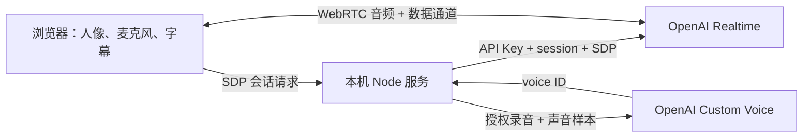

# AI 实时交互数字人：实现方案

## 当前实现（2026-10-10）

当前使用豆包端到端实时语音和用户的固定复刻音色，网页保持纯语音交互；本机 OpenVINO/Wav2Lip256 处理口型，照片局部动效处理基础眉眼、头部和手腕联动。ChatGPT 会员连接已移除。

当前只有一个「旅游景区」入口，身份为景区讲解员。GuideStore 从本地已保存资料加载一套景区内容；没有已保存资料时，读取 `knowledge/catalog.json` 指定的承德避暑山庄短版资料。浏览器沿用 scenic 场景 ID，由服务器建立讲解规则，再通过既有语音 WebSocket 送入会话。数字人不使用固定个人姓名，交流偏好仅控制表达风格。schema1/2 三套资料迁移前完整备份，保留已有 scenic 资料；schema3 读写通过同一队列执行，不自动覆盖已有编辑。本次按用户要求单独备份并将当前虚构资料替换为真实避暑山庄。保存资料会结束当前会话，下一次开始使用新内容；照片与音色保持原配置。来源条目、核对日期和公告有效期记录在知识目录，当前没有在线 RAG 检索，操作与边界见[景区旅游讲解样例](文旅展馆场景演示.md)与[全国景区知识库规划](全国景区知识库规划.md)。

以下为早期 OpenAI Realtime 方案记录，其字幕、账号接入和人物呈现描述不代表当前默认实现。

## MVP 目标

用户提供最新人像和原声录音；打开网页直接对数字分身讲话，听到 AI 回答，看到双方字幕，允许插话打断。用户录音用于专属音色创建，不把原声试听等同于声音克隆。

## 架构

关键设计：API Key 始终留在本机服务。模型采用指定的 `gpt-realtime-2.1-mini`。服务器调用 `/v1/realtime/calls`，把 SDP answer 返回浏览器；客户端建立原生音轨和事件数据通道。

## 对话与打断

- 输入转写使用 `gpt-4o-mini-transcribe`，语言设为 `zh`。
- 回合检测采用 `semantic_vad`；`create_response` 和 `interrupt_response` 都为 true。
- 用户开始说话时更新“聆听”状态，标记正在回答的字幕为已打断，忽略已取消回答的迟到增量。
- 手动打断对仍在生成的 response 发送 `response.cancel`，并发送 `output_audio_buffer.clear` 清除尚未播放的音频。
- 生成完成和扬声器播放完成分别处理，不以 `response.done` 误判声音已播完。
- 结束时关闭数据通道、PeerConnection 和麦克风音轨；失败允许重连。

## 专属音色

数字人只绑定用户上传声音对应的一个专属音色。参考录音已降噪，创建接口使用 24 kHz 单声道 PCM WAV。录音长度属于素材信息，不限制数字人生成回答的时长。

界面不提供音色切换；后端每次建立会话都取同一个专属 voice ID。旧的浏览器音色选择自动清除，客户端尝试指定其他声音会被拒绝。系统声音合成接口和预览已移除。

创建需要两个不同用途的录音：上传的样本，以及同一说话人录制的指定授权语句。网页录音后由用户主动提交，后端先创建 `voice_consent`，再创建 `voice`。音色 ID 保存在非公开目录。若账号尚未开通自定义音色、授权不匹配或请求失败，页面显示真实错误。不会声称“已克隆”或自动替换为内置音色。

## V1 的人物呈现

直接使用最新人像，图片不自动传给外部视频服务。分析实际输出音频振幅，用来驱动波形、光效和轻微呼吸动作。V1 没有写实唇形同步。

## V2 的扩展边界

后续可将 `AvatarRenderer` 换为接收实时视频流的渲染器。视频引擎接收经获准的照片和 AI 输出音频，输出写实人物视频，再由 WebRTC / LiveKit 分发。选择具体视频供应商后需单独验证中文效果、音频接口、端到端延迟、打断清空和付费账户权限。本次尚未接入该引擎。

## 验收与当前依赖

已使用降噪参考录音与原生浏览器 WebRTC 双端测试音频和控制流程，并检查固定音色约束。外部实测依赖用户配置 API Key、有效额度、可用网络及自定义音色权限。授权语句可直接在应用内录制。

接口以 [WebRTC 官方文档](https://developers.openai.com/api/docs/guides/voice-webrtc?voice-api=realtime)、[VAD 文档](https://developers.openai.com/api/docs/guides/realtime-vad) 和 [自定义音色文档](https://developers.openai.com/api/docs/guides/custom-voices) 为准；查阅日期为 2026-10-08。
